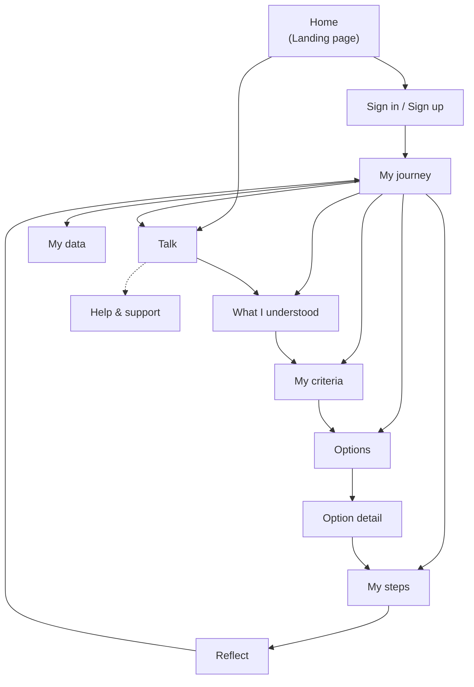

# Sitemap – Embrace

Derived from [user-stories.md](user-stories.md). Each page lists the user stories it serves.

## Diagram

## Pages

### Must (first prototype)

| Page | Description | Stories |
|------|-------------|---------|
| **Home** | Explains in a few words what Embrace does and invites people to just start talking. | 1 |
| **Talk** | An open conversation where people share what's on their mind and Embrace first clarifies what is most urgent. | 1, 2 |
| **What I understood** | A summary that clearly separates what the person said from what Embrace infers, with every point open to correction. | 3 |
| **Options** | A list of concrete career paths, each with a short explanation of why it fits or doesn't. | 4 |
| **Option detail** | One option in depth, with its reasons and suggested small experiments to try it out. | 4, 5 |
| **My steps** | The small first steps the person has chosen, such as a conversation, some research or a small task. | 5 |

### Should

| Page | Description | Stories |
|------|-------------|---------|
| **Sign in / Sign up** | Lets people come back to their journey without starting from scratch. | 7 |
| **My journey** | The overview that brings together insights, open questions and decisions across all conversations. | 7 |
| **My criteria** | Shows the strengths, values and needs collected from the conversations in one place. | 6 |
| **Help & support** | Says openly when more support than an AI is needed and points to coaches, counselling and crisis services. | 8 |

### Could

| Page | Description | Stories |
|------|-------------|---------|
| **Reflect** | A space to note what a step taught the person and how it changes their direction. | 9 |
| **My data** | Lets people view, download and completely delete their saved conversations and insights. | 10 |

## Notes

- **Sign in / Sign up** is not a story of its own; it follows from story 7, because a journey can only be remembered if people can return to it.
- **Help & support** is reachable from every page, shown here with a dotted line from *Talk*, where the need usually comes up.
- The main path follows the journey from the README: talk → understand → criteria → options → small step → reflect.
