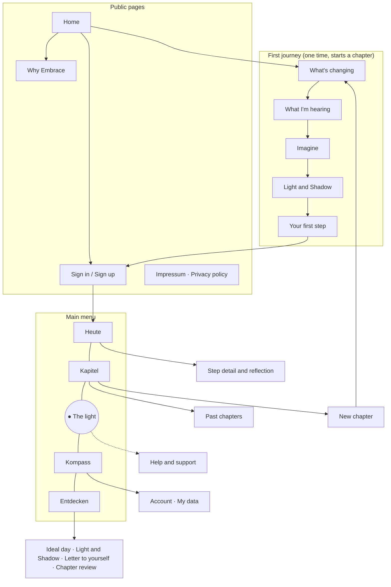

# Sitemap – Embrace

Derived from [user-stories.md](user-stories.md) and [decisions.md](decisions.md). Each page lists the user stories it serves.

**Structure in short:** public pages lead into a first journey. After that, everything lives in a main menu with four tabs and the light in the middle: **Heute · Kapitel · ● · Kompass · Entdecken**.

## Diagram

## Public pages

| Page | Description | Stories |
|------|-------------|---------|
| **Home** | Explains in a few words what Embrace does and invites people to just start talking. | 1 |
| **Why Embrace** | The founder's story, the values and the promise that the person's data is theirs. | 16 |
| **Sign in / Sign up** | Saves the first journey so people can come back to it; offered after the first step, not before. | 7 |
| **Impressum · Privacy policy** | The legally required pages for a website in Germany. | 16 |

## First journey (Must)

This flow runs once at the start of each chapter. It follows the Light and Shadow method (see [decisions.md](decisions.md)).

| Page | Description | Stories |
|------|-------------|---------|
| **What's changing** | An open conversation with the light that first sorts what is urgent (must) from what the person wants. | 1, 2 |
| **What I'm hearing** | A short reflection in the person's own words that separates what they said from what Embrace guesses, with a "not quite" link to correct it. | 3 |
| **Imagine** | The person describes a day when the change has gone well; this becomes the chapter's vision. | 4 |
| **Light and Shadow** | The person names the inner obstacle in the way and makes their own if-then plan. | 5 |
| **Your first step** | The person chooses one small, doable step to take right away. | 6 |

## Main menu

| Tab | Description | Stories |
|-----|-------------|---------|
| **Heute** | Shows the current step with its if-then plan, today's question and upcoming moments. | 6, 9, 14 |
| **Kapitel** | The current chapter with its vision at the top, the must and want lanes, steps, insights and how the vision has changed. | 2, 7, 8 |
| **● The light** | Opens a conversation from anywhere in the app. | 1 |
| **Kompass** | Strengths, values, needs and energy givers across all chapters, each marked as assumed, tested or confirmed. | 3, 10 |
| **Entdecken** | Guided exercises to use any time: ideal day, Light and Shadow, finding your own options, letter to yourself, chapter review. | 4, 5, 11, 15 |

## Pages inside the tabs

| Page | Reached from | Description | Stories |
|------|--------------|-------------|---------|
| **Step detail and reflection** | Heute | A single step with its if-then plan and a place to note what was learned. | 6, 9 |
| **Past chapters** | Kapitel | All closed chapters with their vision, letter and key insights. | 13 |
| **New chapter** | Kapitel | Closes the current chapter with a short review and starts the first journey again. | 13 |
| **Account · My data** | Kompass | Lets people view, download and delete everything Embrace has saved. | 16 |
| **Help and support** | Everywhere | Says openly when more support than an AI is needed and points to coaches, counselling and crisis services. | 12 |

## Notes

- **Sign in comes after the first step.** People should be able to start talking before creating an account.
- **Help and support** is reachable from every screen; the diagram shows it with a dotted line from the light.
- **Free or paid** is still open (see [decisions.md](decisions.md)). It will decide which tabs belong to Embrace Change (free tracker) and which to Embrace (paid companion).
- The V4 prototype tabs map as follows: Today → Heute, Chapter → Kapitel, Rituals → Entdecken, Journal → part of Kapitel.
